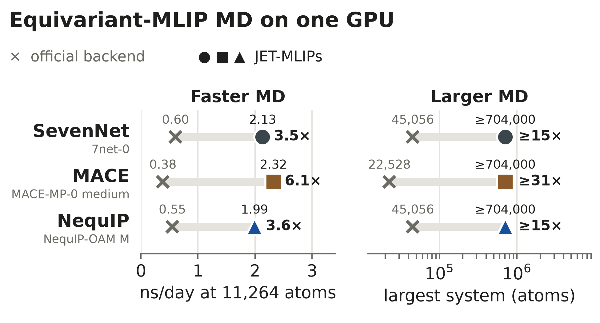

# JET-MLIPs: Joint-Kernel Equivariant Convolution with Tabulated Radial Weights for accelerated MLIP simulation

Faster MD simulation using equivariance potentials: up to ~6x faster.

JET-MLIPs accelerates MD simulation without re-training; only swaps equvariant IPs' convolution for one fused GPU kernel (JET).



LAMMPS on one NVIDIA H200 (141 GB), jet-mlips v0.3.1, JET kernel + radial table, no D3. Left: ns/day of an  
11,264-atom electrolyte (0.5 fs, rebuild-free step time; not the 5632-atom step times below).


| family   | official package             | models                                                                                                                    |
| -------- | ---------------------------- | ------------------------------------------------------------------------------------------------------------------------- |
| SevenNet | sevenn 0.13.0                | 7net-nano, 7net-0, 7net-mf-0, 7net-omni                                                                                   |
| MACE     | mace-torch 0.3.16            | MP-0 / MPA-0 / OMAT-0 small and medium, MP-0 large, MP-0b3 medium, MATPES-PBE-0 / -r2SCAN-0, OFF23 small / medium / large |
| NequIP   | nequip 0.19.1                | NequIP-OAM-S / M / L / XL 0.1, NequIP-MP-L 0.1, models with per-edge-type cutoffs                                         |
| Nequix   | nequix 0.4.5 (torch backend) | nequix-mp-1, nequix-oam-1                                                                                                 |
| EquFlash | GGNN (SamsungElectronics)    | EquFlash-OAM-30M (v1), EquFlashV2-OAM                                                                                     |


How it works: `docs/design.md`.

## 1. Prerequisites

- Linux with an NVIDIA GPU and its driver (tested: sm_75, sm_86, sm_89, sm_90).
- A conda env per family (SevenNet and NequIP can share one; MACE needs its own, it pins e3nn 0.4.4) with:
  - PyTorch with CUDA, and the CUDA toolkit (`nvcc`) of the same CUDA version;
  - g++ 12 and `ninja` (to build JET);
  - the official package:


| family   | official package (pip install, into the env)                                                                                                                                         |
| -------- | ------------------------------------------------------------------------------------------------------------------------------------------------------------------------------------ |
| SevenNet | `sevenn==0.13.0`                                                                                                                                                                     |
| MACE     | `mace-torch==0.3.16` and cuEquivariance (`cuequivariance-torch`, `cuequivariance-ops-torch-cu12`; `-cu13` for CUDA 13 torch): 0.9.1 for torch &lt; 2.11, 0.13.0 for torch &gt;= 2.11 |
| NequIP   | `nequip==0.19.1`                                                                                                                                                                     |
| Nequix   | `"nequix[torch]==0.4.5"`                                                                                                                                                             |
| EquFlash | GGNN from github.com/SamsungDS/GGNN                                                                                                                                                  |


Tested torch and CUDA (Python 3.12, g++ 12; each family's tests and forces against the official model, v0.3.1):


| torch  | CUDA             | SevenNet | MACE            | NequIP | Nequix | EquFlash |
| ------ | ---------------- | -------- | --------------- | ------ | ------ | -------- |
| 2.7.1  | 12.6, 12.8       | yes      | yes             | yes    | yes    | yes      |
| 2.8.0  | 12.6, 12.8       | yes      | yes (2x slower) | yes    | yes    | yes      |
| 2.9.1  | 12.6, 12.8, 13.0 | yes      | yes (2x slower) | yes    | yes    | yes      |
| 2.10.0 | 12.6, 12.8, 13.0 | yes      | yes (2x slower) | yes    | yes    | yes      |
| 2.11.0 | 12.6, 12.8, 13.0 | yes      | yes (2x slower) | yes    | yes    | yes      |


- LAMMPS (optional): cmake and, for several GPUs, an MPI (tested Open MPI 4.1 and 5.0). `lammps/build_lammps.sh`
fetches the LAMMPS source and installs `cython==3.0.11` and `cupy` into the env.

## 2. Install

Install the official package first (section 1), then build JET in the same env:

```bash
conda create -n <env> python && conda activate <env>   # then the official package into it (section 1)
git clone https://github.com/yanselmo-jk/jet-mlips.git && cd jet-mlips
JET_CONFIGS=all JET_CUDA_ARCH=90 MAX_JOBS=4 pip install -e jet_mlip --no-build-isolation
pip install -e . --no-deps
python -m jet_mlip.patch_sevenn      # SevenNet only
python -m common.patch_tool mace     # MACE only
```

- `JET_CONFIGS`: the model families whose kernels are compiled. `all` (default) builds every family; a comma list
builds only those, e.g. `JET_CONFIGS=mace` or `JET_CONFIGS=sevenn,nequip` (names: `sevenn`, `mace`, `nequip`,
`nequix`, `equflash`). Each family covers all its supported models. Rebuild with the same value.
- Build time and memory (measured on an H200 server with `MAX_JOBS=32`): `all` about 5 min, `mace` about 1.5 min.
The largest kernel needs about 7 GB RAM per compile job (`mace` only: 3 GB), so total RAM grows with `MAX_JOBS`.
Compiler out of memory: use `MAX_JOBS=1 JET_LOW_RAM=1`.
- `JET_CUDA_ARCH`: your GPU's compute capability without the dot (8.9 -&gt; `89`); look it up at
[https://developer.nvidia.com/cuda/gpus](https://developer.nvidia.com/cuda/gpus).
- The build belongs to the env's torch: use one checkout per env and run from it.
- Patch (SevenNet and MACE only, once per env): they call JET from inside the installed package, for ASE and LAMMPS
alike; the other three are rewritten after loading. Patches take `--check` (dry run) and `--reverse` (undo).

## 3. Use

### ASE

```python
# SevenNet
from sevenn.calculator import SevenNetCalculator
calc = SevenNetCalculator('7net-0', enable_jet=True)

# MACE
from mace.calculators import mace_mp
from jet_mace import convert
calc = mace_mp(model='medium', device='cuda', default_dtype='float32')
calc.models[0] = convert.patch_model(calc.models[0], cueq=True)

# NequIP
from nequip.integrations.ase import NequIPCalculator
from jet_nequip import convert
calc = NequIPCalculator._from_saved_model('nequip.net:mir-group/NequIP-OAM-M:0.1', device='cuda',
                                          chemical_species_to_atom_type_map={'Si': 'Si'})   # map: your elements
calc.model = convert.patch_model(calc.model)

# Nequix
from nequix.calculator import NequixCalculator
from jet_nequix import convert
calc = NequixCalculator('nequix-mp-1', backend='torch', use_kernel=False)
calc.model = convert.patch_model(calc.model)

# EquFlash
from GGNN.common.calculator import UCalculator
from jet_equflash import convert
calc = UCalculator(checkpoint_path='equflash_oam_30M.pt', cpu=False)
convert.patch_model(getattr(calc.trainer.model, 'module', calc.trainer.model))
```

**D3 dispersion** (any family): `jet/d3`, the same GPU kernel as the LAMMPS pair style, added on top of any of the
calculators above. Build once per env:

```bash
JET_CUDA_ARCH=90 pip install -e jet_d3/ase --no-build-isolation
```

Example, MACE + D3(BJ, PBE):

```python
from ase.build import bulk
from ase.calculators.mixing import SumCalculator
from mace.calculators import mace_mp
from jet_mace import convert
from jet_d3_ase import JetD3Calculator

mace = mace_mp(model='medium', device='cuda', default_dtype='float32')
mace.models[0] = convert.patch_model(mace.models[0], cueq=True)
calc = SumCalculator([mace, JetD3Calculator(xc='pbe')])   # model + D3; damping='bj' (default) or 'zero'

atoms = bulk('Si', 'diamond', a=5.43, cubic=True).repeat((2, 2, 2))
atoms.calc = calc
print(atoms.get_potential_energy(), atoms.get_forces().shape, atoms.get_stress())
```

The same `SumCalculator([calc, JetD3Calculator(...)])` works with the SevenNet, NequIP, Nequix and EquFlash
calculators. `xc` is the functional of the model's training data (e.g. `'pbe'`, `'r2scan'`).
`params={'s6': ..., 's8': ..., 'a1': ..., 'a2': ...}` sets custom BJ parameters instead of `xc`; `cutoff` / `cn_cutoff`
in Å (defaults: those of `jet/d3 9000 1600`). Energy, forces and stress (stress for fully periodic cells); one GPU.

### LAMMPS

**1. Build LAMMPS** in the env of sections 1-2 (it adds the ML-IAP patches that every family runs on):

```bash
conda activate <env>
bash lammps/build_lammps.sh              # installs `lmp` into this env: pair_style jet/mliap (ML-IAP), jet/d3
SEVENN=1 bash lammps/build_lammps.sh     # instead: the same plus SevenNet's pair_style e3gnn
```

`lmp` runs inside this env (activate it first). Build it once in every env you run.

**2. Deploy the model to one file:**

```bash
python -m jet_mlip.deploy <family> <model> [<output>.pt]      # <family> --help: options
```

```bash
python -m jet_mlip.deploy mace medium medium_jet.pt      # MACE-MP medium -> medium_jet.pt
```

Without `<output>` the file is `jet_deployed_<model>.pt`; NequIP outputs must end with `.nequip.lmp.pt`. All families:

```bash
python -m jet_mlip.deploy sevenn   7net-0                                   7net-0.mliap.pt
python -m jet_mlip.deploy mace     medium                                   medium_jet.pt
python -m jet_mlip.deploy mace     off-large                                off-large_jet.pt
python -m jet_mlip.deploy nequip   nequip.net:mir-group/NequIP-OAM-L:0.1    oam-l.nequip.lmp.pt
python -m jet_mlip.deploy nequix   /path/to/deployed/nequix_checkpoint.pt    nequix-mp-1.mliap.pt
python -m jet_mlip.deploy equflash equflash_oam_30M.pt                      eqf.mliap.pt
```

`<model>` is what the official package accepts: a pretrained name (`7net-0`, `medium`, a nequip.net id) or a checkpoint file; MACE-OFF23 is `off-small` / `off-medium` / `off-large`.  
A fine-tuned checkpoint file works the same way. LAMMPS needs deployed *.pt file.

Deploy options (add them to the `python -m jet_mlip.deploy` line):

- `--radial_table N`: grid points of the tabulated radial weights (default: MACE 4096, others 2048). The defaults keep
the table's force error well below the official fp32 error (`docs/design.md`). SevenNet: `0` = exact, no table.
- `--no-graph`: the official ML-IAP wrapper instead of the CUDA-graph one (slower; for comparison or debugging).
- `--no-jet`: deploy the official model unchanged, for A/B comparison. MACE: `--no-jet` is not supported; use the
official `mace_create_lammps_model <model> --format mliap` instead.
- SevenNet: `--modal NAME`, the modal of a multi-fidelity model (e.g. `7net-omni`).
- MACE: `--head NAME`, which output head of a multi-head model to run (default: the last head. the official models have one).

**3. Run:**

```
pair_style jet/mliap medium_jet.pt              # any deployed file
pair_coeff * * Li C H O N F S P B               # elements in LAMMPS type order
thermo_style custom step pe temp                # keep a model quantity in the thermo output
```

`jet/mliap` is `mliap unified <file> 0` (which still works) on KOKKOS only: run with `-k on g N -sf kk`; without KOKKOS
the style does not exist.

```bash
lmp -k on g 1 -sf kk -pk kokkos newton on neigh half -in in.lammps
```

Example inputs: `lammps/examples/` (`in.mliap_d3`: any deployed file + D3; `in.sevenn_d3`: SevenNet `e3gnn` + D3;
348-atom LiPF6 EC/EMC box).

Environment variables, set in front of `lmp` (e.g. `JET_MACE_CUDA_GRAPH=0 lmp ...`):

- `JET_<FAMILY>_CUDA_GRAPH=0`: run without the CUDA graph (`<FAMILY>` = `SEVENN`, `MACE`, `NEQUIP`, `NEQUIX`, `EQUFLASH`).
- `JET_MACE_COMPILE=0`, `JET_NEQUIP_COMPILE=0`: no torch.compile (also read by deploy).
- `JET_MLIAP_CHECK=N` (debug): every N-th step and after atoms migrate, compare the step with an eager rerun and check
LAMMPS' element types; stops the run on a mismatch.

**Several GPUs** (one node, one GPU per rank, the same deployed file):

```bash
mpirun -np N lmp -k on g N -sf kk -pk kokkos newton on neigh half gpu/aware off -in in.lammps
```

Worth it from ~50k atoms per GPU (3 H200: 360k atoms 1.9-2.2x faster).

**D3 dispersion** (every family): `pair_style jet/d3` on the GPU, overlaid on the model.

```
pair_style hybrid/overlay jet/mliap medium_jet.pt jet/d3 9000 1600 damp_bj pbe
pair_coeff * * jet/mliap Li C H O N F S P B
pair_coeff * * jet/d3 Li C H O N F S P B
```

`jet/d3 <r_cut^2> <CN r_cut^2> <damping> <functional>` (squared cut-offs in bohr^2) 

&lt;damping&gt;:`damp_zero` or `damp_bj`

&lt;functional&gt;: functional name such as `pbe`, or `custom s6 s8 a1 a2` with `damp_bj`.

**SevenNet's own pair style** `e3gnn` (faster than ML-IAP for small cells; needs the `SEVENN=1` LAMMPS build):

```bash
sevenn get_model 7net-0 --enable_jet -o model.pt
```

```
pair_style e3gnn
pair_coeff * * model.pt Li C H O N F S P B
```

```bash
lmp -in in.lammps
```

### Offline machines

Nothing in JET needs the network: give local files instead of names and downloads. Step by step:
`docs/offline-installation.md`.

## 4. Limits

- Multi-GPU: one node only. Two multi-GPU runs on one node: give each its own port, `mpirun -x MASTER_PORT=29541 ...`.
- EquFlash V2 runs without the CUDA graph (slower than v1).
- Not supported: MACE-OMOL, 7net-l3i5.
- Training is not supported. The SevenNet / MACE train-mode path (tp3 kernels) is built only with
`JET_TRAIN=1` and is not maintained here.
- A model with a layer shape JET was not built for stops with `jet: config not compiled: <shape>`. Add its shapes
and rebuild (any family):
  ```bash
  python -m jet_mlip.shapes <family> <model> --apply   # <model> as for deploy; appends the missing shapes to jet_mlip/configs.py
  JET_CONFIGS=all JET_CUDA_ARCH=90 MAX_JOBS=4 pip install -e jet_mlip --no-build-isolation   # rebuild (section 2, same JET_CONFIGS)
  ```

## 5. Check and test

```bash
python -m pytest tests/<family>_jet       # in that family's env, GPU
python -m pytest jet_mlip/tests            # kernel and shared LAMMPS wrapper
```

## 6. Update

```bash
python -m common.patch_tool mace --reverse; python -m jet_mlip.patch_sevenn --reverse
git pull
```

Then repeat sections 1-2 and deploy the models again.

## Citation

If you use JET-MLIPs, please cite: [arXiv:2611.31865](https://arxiv.org/abs/2611.31865)

## License

CC BY-NC-SA 4.0 (`LICENSE`): non-commercial use; commercial use needs written permission. Files derived from LAMMPS (`lammps/*.patch`, `jet_d3/` with `jet_d3/ase/`, the SevenNet pair styles) are GPL-2.0.
GGNN (EquFlash) is CC BY-NC-SA 4.0: it is loaded, not copied. Model weights are not redistributed.